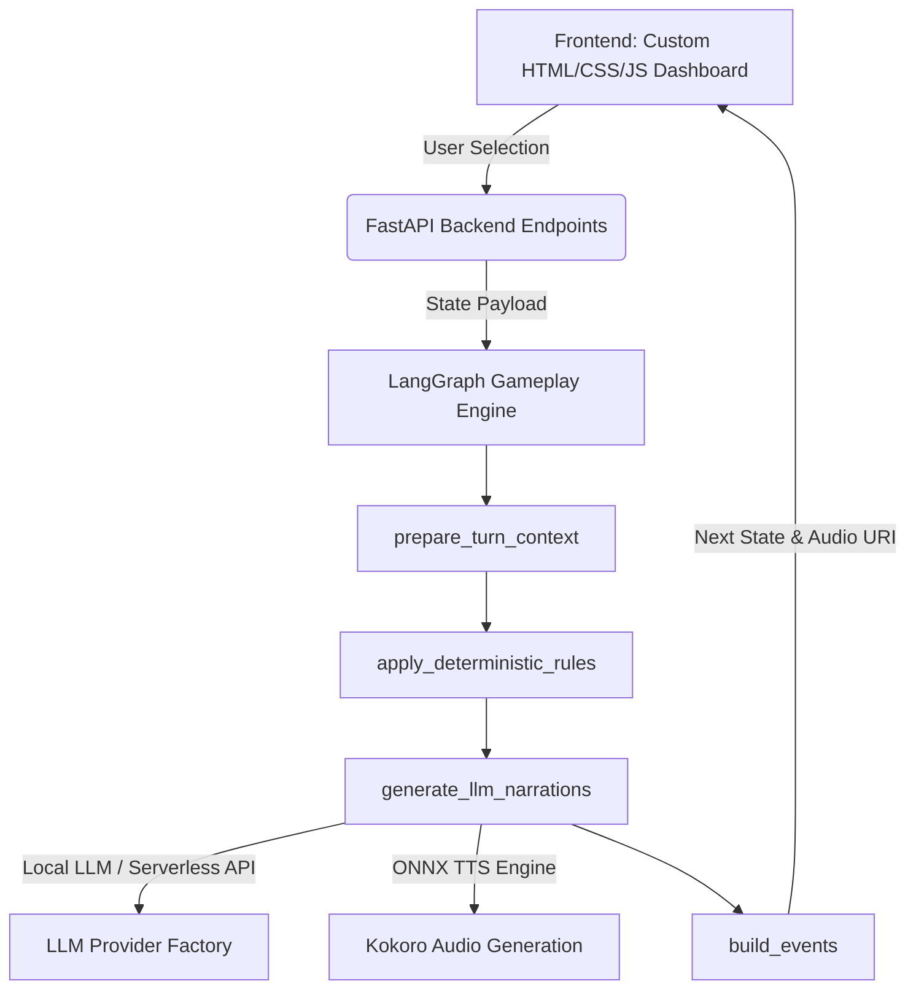

*Check out the configuration reference at https://huggingface.co/docs/hub/spaces-config-reference*

# 🏔️ YAKGPT: Can You Survive Thorong La?


**Track Submission:** 🍄 An Adventure in Thousand Token Wood

---

## 📖 Summary
**YakGPT: Can You Survive Thorong La?** is a choices-matter high-altitude mountain survival simulator. You play as a slightly reckless tourist navigating the treacherous Himalayan Annapurna Circuit pass of Thorong La. 

Your guide? **Tashi the Yak**, the world's most sarcastic, judgmental, and world-weary local pack animal. While Tashi serves brutal comedic roasts about your flatlander decision-making, an underlying stateful simulation rigorously tracks real-world trekking physiology. 

Make reckless choices to save time, and your vitals drop alongside your Sherpa's respect. Can you survive the pass, or will you end up as a frozen warning sign for future tourists?

---

## 💡 The Inspiration & Real-World Impact
Every trekking season, hundreds of tourists endanger themselves and local guides by ignoring altitude warnings, rushing schedules, or disrespecting indigenous mountain wisdom. Many Nepalese locals and tourists hike without guides to save money, placing them at extreme risk.

I built YakGPT to teach players about **Acute Mountain Sickness (AMS)**, weather cues, and proper trail planning in a fun, sarcastic, and unforgettable way.

---

## 🏗️ Project Architecture

YakGPT is built as a stateful, event-driven web application. It rejects basic chatbot conversations in favor of a full-fledged survival dashboard.



### 1. The Frontend
A premium, responsive survival dashboard served as static HTML/CSS/JS. No standard chat input box here—players interact using dynamic choice cards, tracking their telemetry in real-time.

### 2. The FastAPI Backend (`app.py`)
Exposes REST endpoints that act as the bridge between the browser UI and the state machine. It handles game instantiation, action processing, and assets routing.

### 3. The LangGraph Engine (`backend/graph/nodes.py`)
The gameplay logic is controlled by a stateful graph:
*   **Context Prep (`prepare_turn_context`)**: Resets flags, advances micro-turn counters, and tracks day/night loops.
*   **Deterministic Physics (`apply_deterministic_rules`)**: Simulates physiological effects (oxygen saturation drops, storm pressure escalation, health depletion).
*   **Dynamic Narrations (`generate_llm_narrations`)**: Triggers three parallel/sequential prompts:
    1.  *Yak Narration*: Tashi roasting your decisions.
    2.  *Atmosphere text*: The environment's oppressive feedback.
    3.  *Sherpa's Journal*: Dorje’s private log.
*   **Event Builder (`build_events`)**: Generates choices based on your current location and altitude.

---

## 🎮 The Gameplay Engine & Physics
Survival isn't just a gimmick; the engine tracks real-world trekking telemetry:

| Metric | Description | What happens if it goes wrong? |
| :--- | :--- | :--- |
| **Altitude** | How high up the mountain you are. | Oxygen decreases, AMS risk multiplies exponentially. |
| **Health** | Your general physical state. | If this hits 0, you become permanent mountain decorations. |
| **Energy** | Vitality reserves. | Dropping too low reduces recovery and makes you vulnerable. |
| **Acclimatization** | Your body's adjustment to thin air. | Rushing upwards without taking rest days triggers AMS. |
| **Guide Trust** | Your guide Dorje's respect for you. | If trust is low, Dorje will refuse to share life-saving advice when the storm hits. |
| **Storm Pressure** | The creeping blizzard coming up behind you. | If you stay in one spot too long, you'll be swallowed by a whiteout. |

---

## 🧠 The Brains: Models & Inference

YakGPT uses two completely different LLM execution architectures depending on where you run it:

```
                  ┌───────────────────────┐
                  │   YakGPT Game Loop    │
                  └───────────┬───────────┘
                              │
               ┌──────────────┴──────────────┐
               ▼                             ▼
        [ LOCAL RUNNING ]             [ HF SPACE RUNNING ]
     llama.cpp Local Server          HF Serverless API
     Quantized Q4 GGUF (8B)        Remote API Endpoint (7B)
     Zero Latency (Offloaded)      Zero Setup / Token Free
```

### 1. Narrative Generation (LLMs)

#### 🏡 Local Development: `llama.cpp`
*   **Model**: `Llama-3.1-128k-Dark-Planet-Uncensored-8B-GGUF` (renamed as `dark-planet-8b.gguf` in config).
*   **Execution**: Run locally on your host using `llama.cpp`'s high-performance server. The backend queries it locally via the `openai` compatible standard endpoint (`http://localhost:8080/v1`).
*   **CUDA Offloading**: Build `llama.cpp` with CUDA support to offload model layers directly to your local GPU for rapid response times.

#### ☁️ Production Deployment (Hugging Face Spaces): Serverless Inference API
*   **Model**: `Qwen/Qwen2.5-7B-Instruct`
*   **Execution**: To avoid massive container memory footprints (preventing CPU OOM crashes) and the high latency/quota consumption of ZeroGPU, the Space utilizes the **Hugging Face Serverless Inference API**. 
*   **Benefits**: Runs on HF's premium GPU clusters, handles token streaming out-of-the-box, has zero startup delay, and is completely free.

### 2. Audio Engine (Text-to-Speech)
*   **Model**: `Kokoro-82M` (Kokoro v1.0 ONNX).
*   **Execution**: Runs completely locally inside the container on the CPU (`CPUExecutionProvider`) using `kokoro-onnx`.
*   **Voice**: `bm_george` (A delightfully dry British male voice, adding a posh flavor to Tashi's sarcasm).
*   **Audio Format**: Audio is synthesized entirely in RAM and returned to the frontend as a Base64 WAV URI.

---

## 🛠️ Setup & Local Running

### Prerequisite: Build `llama.cpp` with CUDA (Local Only)
To get fast, GPU-accelerated local narration, download and install the **CUDA Toolkit**, then compile `llama.cpp`:
```bash
# Setup gcc compiler path if using modern Linux environments
export CC=/usr/bin/gcc-15
export CXX=/usr/bin/g++-15
export CUDAHOSTCXX=/usr/bin/g++-15

# Build using CMake with CUDA offloading enabled
cmake -B build -G Ninja -DGGML_CUDA=ON
cmake --build build -j12
```

Download the model `Llama-3.1-128k-Dark-Planet-Uncensored-8B-GGUF` and launch the local server:
```bash
./build/bin/llama-cli -m ~/models/llama/dark-planet-8b.gguf -ngl 32 -p "Hello!"
```

### Installation
1. Clone this repository.
2. Install Python 3.12 dependencies using `uv` (recommended) or pip:
   ```bash
   uv sync
   ```
3. Copy `.env.example` to `.env` and configure your active LLM provider:
   ```env
   LLM_PROVIDER=llama.cpp  # Change to "huggingface" for Serverless
   HF_TOKEN=your_token_here
   ```
4. Run the development server:
   ```bash
   python app.py
   ```

---

## 🚀 Hugging Face Space Configuration
When deploying this project to Hugging Face Spaces:
1. Ensure the Space settings are configured with **Docker SDK** pointing to our `Dockerfile`.
2. Add your `HF_TOKEN` as a **Secret** in your Hugging Face Space settings.
3. Configure the Space's Environment variables:
   *   `LLM_PROVIDER=huggingface`
   *   `HF_MODEL_NAME=Qwen/Qwen2.5-7B-Instruct`